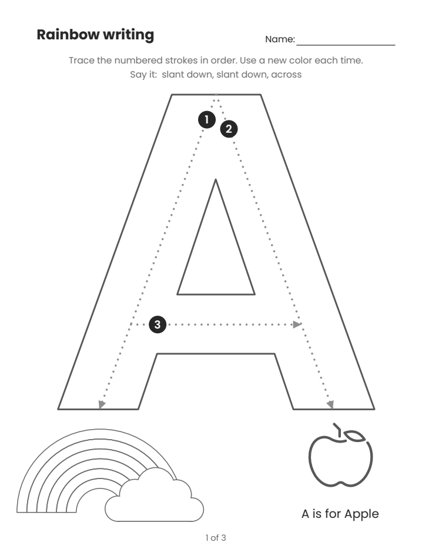

# Rainbow Writing Worksheet: a Claude skill

This [Claude skill](https://docs.claude.com/en/docs/agents-and-tools/agent-skills/overview) lets Claude make printable "rainbow writing" alphabet worksheets for young children (preschool and kindergarten).



Each page is 8.5x11 and has:

- **A giant hollow capital letter** with numbered, dotted stroke-order guides (standard manuscript order).
- **A "Say it:" cue** that the child says while writing the letter.
- **A six-band rainbow:** the child colors one band after each tracing pass.
- **A friendly line-art picture** with a caption, for example "A is for Apple".
- **A name line** and page numbers ("1 of 3").

The skill makes the whole alphabet or just the letters you ask for, and saves them as one PDF. Besides A to Z, it can make **Ñ, Ç and Ü**. To add more letters, see **[ADDING-LETTERS.md](ADDING-LETTERS.md)**.

## Install

### In Claude Code

Clone this repo into your skills folder:

```
git clone https://github.com/jamespostsil/rainbow-writing-worksheet.git ~/.claude/skills/rainbow-writing-worksheet
```

Then install the Python packages it uses:

```
pip install reportlab fonttools numpy pillow opencv-python scikit-image pypdfium2
```

All fonts are included, so you do not need to download anything else.

### On claude.ai (or the Claude desktop app)

1. Download **rainbow-writing-worksheet-skill.zip** from the [latest release](https://github.com/jamespostsil/rainbow-writing-worksheet/releases/latest). Do not unzip it.
2. In Claude, open **Settings**, then **Capabilities**.
3. Make sure **Code execution** is turned on.
4. Under **Skills**, click **Upload skill** and choose the zip file.

## Use it

Ask Claude in normal words, for example:

- "Make rainbow writing worksheets for the whole alphabet."
- "Make letter tracing pages for A, B, and C."
- "Make rainbow writing sheets for the letters in the name MARY."

Claude makes the PDF, checks every page, and gives you the file.

To run the script yourself, without Claude:

```
python scripts/make_rainbow.py --letters ABCDE --out rainbow-writing.pdf
```

- **--letters:** the letters to make. The default is A to Z. Add Ñ, Ç or Ü by name, for example `--letters "ABCÑ"`.
- **--title:** changes the heading on each page.

The script prints one line per page. Every line should say `ok`.

## What's in the repo

- **SKILL.md:** the instructions Claude follows, including the quality rules for every page.
- **ADDING-LETTERS.md:** how to add a letter: the measuring toolkit, letters with marks, how to read the checker, and the traps we hit.
- **scripts/make_rainbow.py:** makes the PDF. The words, pictures, and "Say it" cues for each letter are in the `LETTERS` table at the top of this file.
- **scripts/letterform.py:** works out where the dotted guides go by measuring the real letter shapes in the font.
- **scripts/verify.py:** checks that every dotted guide stays in the middle of its stroke, and writes overlay images to review.
- **assets/fonts/:** the Poppins and OpenMoji fonts, with their licences.
- **docs/:** the sample page shown above. Claude does not need this folder.

## Limits

- **Capital letters only.** Lowercase letters are not built yet. They need their own stroke paths and a school-style font (single-story a and g).
- **Many African letters are missing.** The Poppins font doesn't have letters like Ŋ, Ɛ and Ɔ. Supporting them means changing the font. See [ADDING-LETTERS.md](ADDING-LETTERS.md#using-another-font).
- **English page text.** The keywords can be in any language. The instructions, "Say it" cues and "is for" in the caption are in English.

## Licences

- **Code and instructions:** MIT. See [LICENSE](LICENSE).
- **Poppins font:** SIL Open Font License 1.1. See [assets/fonts/OFL-Poppins.txt](assets/fonts/OFL-Poppins.txt).
- **OpenMoji pictures:** [CC BY-SA 4.0](https://creativecommons.org/licenses/by-sa/4.0/), by [OpenMoji](https://openmoji.org).
  - **For use at home or in a class:** no credit is needed.
  - **If you share the sheets publicly or sell them:** add "Pictures: OpenMoji, CC BY-SA 4.0" on the sheet or in the listing.
